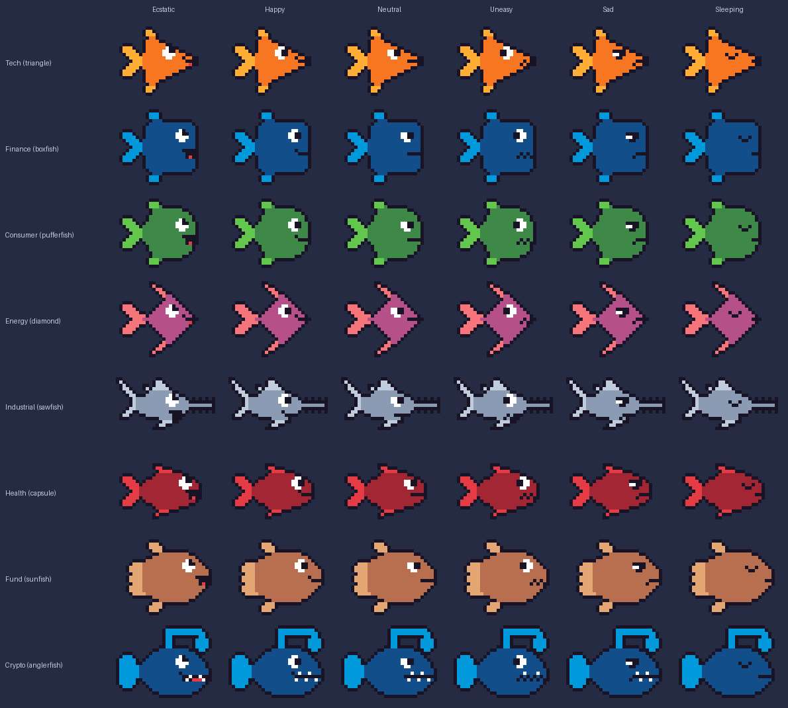

# Stock Fish

Your portfolio as a tank of pixel-art fish. Each fish is one of your holdings, and its face shows
how it's doing today, scaled to how much that stock usually moves. A quick glance replaces a price
board.

Hobby project. Bring your own free market data API key; your holdings never leave your browser.



## What it does

- **Moods:** each fish's face shows today's move compared with a normal day for that stock
  (ecstatic, happy, calm, uneasy, sad). Tap a fish for the real numbers.
- **Pens:** keep fish in several tanks (e.g. Taxable, TFSA). Each fish claims a patch of its pen
  sized by its value; drag fish to rearrange them or onto another pen to move them, or split a
  holding across pens.
- **Overviews:** show several pens at once, arranged by mood, species, family (sector), weight,
  pen or free roam. Tap a group's name, or its water, for that group's weather and share.
- **Pixel-exact UI:** the tank and every screen share one pixel grid, at any screen scaling or
  zoom, with a bitmap font (Silkscreen).
- **Works without a server:** prices come straight from Twelve Data with your own key (or made-up
  demo data); holdings, pens and colours stay in the browser. Export a backup now and then.
- **Installable and accessible:** add it to your home screen or desktop; it opens offline. The tank
  works with a keyboard and screen reader (arrow keys choose fish; numbers are read out).

Not investment advice. Stock Fish only displays prices and never executes trades.

## Running it

Needs Node 22 or later.

```sh
npm install
npm run dev        # http://localhost:5173
npm test           # unit tests
npm run lint       # ESLint
npm run build      # production build in dist/ (with the service worker)
```

To try it on a phone on the same Wi-Fi, run `npm run dev -- --host` and open the "Network" address
it prints. Over plain http on a LAN, browsers don't offer installing the app; that needs HTTPS (or
localhost).

In the app, open **Settings**, choose **Twelve Data** and paste a free key from
[twelvedata.com](https://twelvedata.com/pricing), or choose **Demo data**. On an empty tank,
**Load sample tank** adds made-up fish to try things out.

## Project docs

- Spec: [`docs/SPEC.md`](docs/SPEC.md)
- Sprite style guide: [`art/STYLE.md`](art/STYLE.md)
- Instructions for Claude Code: [`CLAUDE.md`](CLAUDE.md)

Licence: MIT. The Silkscreen font is under the SIL Open Font License
([`art/fonts/OFL-Silkscreen.txt`](art/fonts/OFL-Silkscreen.txt)).
